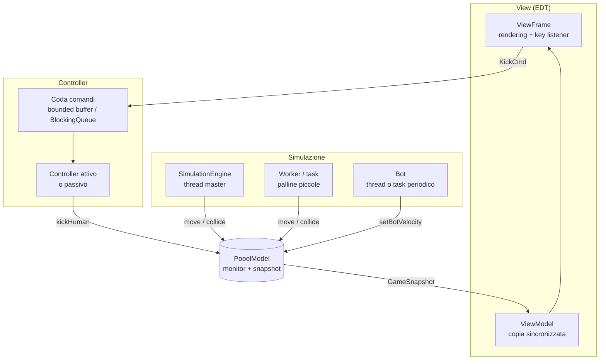
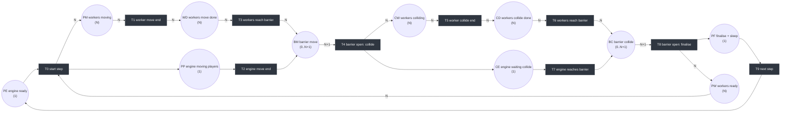
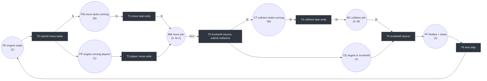
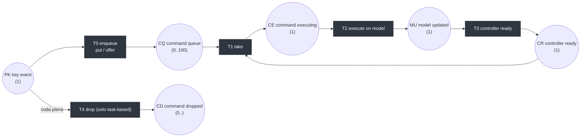

# Assignment-01 Report

## Programmazione Concorrente e Distribuita [25-26]

**Autore:** Nicola Graziotin (`nicola.graziotin@studio.unibo.it`)

---

## Indice

1. [Analisi del problema](#1-analisi-del-problema)
2. [Architettura comune](#2-architettura-comune)
3. [Versione sequenziale](#3-versione-sequenziale)
4. [Versione multithread](#4-versione-multithread)
5. [Versione task-based](#5-versione-task-based)
6. [Petri Net](#6-petri-net)
7. [Test prestazionali](#7-test-prestazionali)
8. [Model checking con JPF](#8-model-checking-con-jpf)
9. [Conclusioni](#9-conclusioni)

---

## 1. Analisi del problema

L'assignment richiede di progettare e realizzare una versione concorrente del gioco
**Poool**, un campo bidimensionale in cui migliaia di palline si muovono, rimbalzano
e collidono, due palline giocatore (umano e bot) e due buche negli angoli superiori.
Il progetto contiene tre implementazioni che condividono modello e vista:

| Versione | Package | Ruolo |
|---|---|---|
| Sequenziale | `poool.sequential` | baseline single-thread, usata come termine di paragone |
| Multithread | `poool.multithread` | thread di piattaforma, barriera e buffer scritti a mano |
| Task-based | `poool.taskbased` | `ExecutorService`, `invokeAll`, `BlockingQueue`, `ScheduledExecutorService` |

Le due versioni richieste dall'assignment sono la multithread e la task-based; la
sequenziale è stata mantenuta come riferimento per misurare il guadagno delle
versioni concorrenti e per isolare il costo della sincronizzazione.

Il codice è organizzato in:

- `poool.common` - modello, viste, configurazioni e comandi condivisi;
- `poool.sequential` - motore, controller e bot sequenziali;
- `poool.multithread` - motore con worker persistenti, barriera e bounded buffer;
- `poool.taskbased` - motore con task, controller e bot basati su Executor Framework;
- `src/jpf` - test e configurazioni JPF.

### 1.1 Requisiti funzionali

- Ogni passo di simulazione aggiorna posizione e velocità di tutte le palline,
  applica l'attrito, fa rimbalzare le palline sui bordi e risolve le collisioni
  elastiche (pallina-pallina e giocatore-pallina).
- Una pallina piccola che cade in una buca viene rimossa; se è stata toccata
  recentemente da una pallina giocatore, il punto va a quel giocatore.
- Il giocatore umano lancia la propria pallina con i tasti freccia; il bot lancia
  autonomamente quando la propria pallina è ferma.
- Il gioco termina quando non restano palline piccole (vince il punteggio più alto)
  oppure quando una pallina giocatore cade in una buca (vince l'avversario).
- Punteggi, palline rimaste ed FPS sono mostrati a schermo.

### 1.2 Aspetti rilevanti dal punto di vista concorrente

Il problema è intrinsecamente concorrente per tre motivi:

1. **Carico computazionale**: la risoluzione delle collisioni è O(n²). Con la
   configurazione `massive` (4500 palline) si esaminano circa 10,1 milioni di
   coppie per passo; un solo core non riesce a mantenere un frame rate accettabile.
2. **Reattività**: l'input umano arriva sul thread Swing (Event Dispatch Thread) e
   non deve essere bloccato dal calcolo; allo stesso modo la vista non deve
   aspettare la fine del passo per ridisegnare.
3. **Attori autonomi**: bot, controller, motore di simulazione e EDT hanno cicli di
   vita e velocità diverse e devono cooperare su uno stato condiviso.

Le principali problematiche di concorrenza affrontate sono quindi:

| Problema | Rischio | Soluzione adottata |
|---|---|---|
| Accesso allo stato del modello | letture parziali, punteggi incoerenti | modello come **monitor** (`synchronized`) |
| Accesso alle singole palline | posizioni/velocità lette a metà aggiornamento | lock **per pallina** |
| Collisioni risolte da worker diversi | deadlock su coppie di lock | acquisizione dei lock in **ordine di `id`** |
| Input umano asincrono | blocco dell'EDT | coda di comandi + controller attivo |
| Notifica della vista | lettura di stato mutabile durante il disegno | **snapshot immutabile** del modello |
| Terminazione | thread appesi su barriera o coda | `interrupt`, `shutdownNow`, `join` con timeout |
| Doppia attribuzione di una buca | punteggio duplicato | `handleHole` atomica e idempotente |

### 1.3 Invarianti e unità atomiche

Le operazioni che devono essere atomiche rispetto agli altri attori sono:

- verifica "pallina ferma" + lancio della pallina umana (`kickHuman`);
- verifica "pallina ferma" + lancio del bot (`setBotVelocity`);
- marcatura di una pallina come "in buca" + aggiornamento punteggio + eventuale
  fine partita (`handleHole`);
- costruzione dello snapshot letto dalla vista (`getSnapshot`).

Queste operazioni sono metodi `synchronized` di `PooolModel`, quindi il monitor del
modello serializza tutte le transizioni composte. Le operazioni puramente
cinematiche (integrazione del moto, rimbalzo, collisione) sono invece protette dai
lock delle singole palline, per permettere il parallelismo.

---

## 2. Architettura comune

### 2.1 Struttura MVC

Tutte e tre le versioni condividono la stessa struttura Model-View-Controller:



- **Model** - `PooolModel` possiede palline, buche, punteggi, stato di fine partita
  e FPS. È il monitor condiviso da tutti gli attori.
- **View** - `View` implementa `PooolObserver`; a ogni notifica copia lo snapshot
  immutabile in `ViewModel` e chiede il repaint di `ViewFrame`. Il key listener
  traduce le frecce in `KickCmd` e li consegna al controller.
- **Controller** - `AController` espone `notifyNewCmd(Cmd)`; `KickCmd.execute`
  applica il comando al modello. Nella versione sequenziale il controller è
  passivo, nelle versioni concorrenti è attivo.
- **Configurazioni** - `BoardConf` con `MinimalBoardConf` (2 palline),
  `LargeBoardConf` (400) e `MassiveBoardConf` (4500). Le buche sono sempre nei due
  angoli superiori.

### 2.2 Il modello come monitor

`PooolModel` è il punto di serializzazione delle decisioni di gioco:

- `kickHuman(V2d)` applica il comando solo se la pallina umana è ferma
  (`vel.abs() <= STOPPED_THRESHOLD`, pari a `0.05`) e la partita non è finita;
- `setBotVelocity(V2d)` fa lo stesso per il bot;
- `handleHole(Ball)` è idempotente: se la pallina è già in buca o la partita è
  finita non fa nulla; altrimenti la marca come olata, aggiorna il punteggio se
  l'ultimo tocco è avvenuto entro `SCORE_WINDOW_MS = 4000` ms, e chiude la partita
  se non restano palline o se è caduta una pallina giocatore;
- `getSnapshot()` restituisce una `GameSnapshot` immutabile con posizioni, raggi,
  punteggi, palline rimaste, stato di fine partita, vincitore e FPS.

Tutti i metodi pubblici che leggono o modificano lo stato condiviso sono
`synchronized`. Le liste di palline non vengono modificate strutturalmente dopo
`init`: una pallina in buca viene solo marcata, non rimossa. Questo permette ai
worker di iterare sulla lista senza rischio di `ConcurrentModificationException`.

### 2.3 Palline e collisioni

Ogni `Ball` è un monitor: `getPos`, `getVel`, `isHoled`, `markHoled`,
`addImpulse`, `setVelocity` e `updateState` sono `synchronized` sull'istanza.

`Ball.resolveCollision(a, b)` risolve una collisione elastica:

1. rimuove la sovrapposizione spostando le due palline in proporzione alla massa;
2. applica l'impulso lungo la normale, con coefficiente di restituzione 1;
3. registra quale giocatore ha toccato per ultimo la pallina piccola.

Per evitare deadlock, i due lock vengono sempre acquisiti nell'ordine crescente
degli `id`:

```java
Ball first  = a.id < b.id ? a : b;
Ball second = a.id < b.id ? b : a;
synchronized (first) {
    synchronized (second) { ... }
}
```

L'ordine totale sui lock rende impossibile un ciclo di attesa, anche quando più
worker risolvono contemporaneamente coppie che condividono una pallina.

I campi `lastTouchedBy` e `lastTouchTime` sono `volatile`: la scrittura avviene
dentro i lock delle palline, la lettura avviene in `handleHole` sotto il monitor del
modello. Non c'è quindi bisogno di un lock aggiuntivo per l'attribuzione del punto.

### 2.4 Snapshot e vista

La vista non legge mai direttamente le palline: `PooolModel.getSnapshot()` crea
una lista immutabile di `BallSnapshot` (posizione, raggio, tipo) e la consegna a
`ViewModel`, che è a sua volta sincronizzato perché scritto dal thread di
simulazione e letto dall'EDT.

Lo snapshot non è una fotografia perfettamente simultanea di tutte le palline,
perché ogni posizione viene letta sotto il lock della singola pallina. Per il solo
rendering è un compromesso accettabile: non viene mai mostrato stato parziale di una
singola pallina, mentre oggetti diversi possono appartenere a istanti leggermente
diversi.

---

## 3. Versione sequenziale

**File principali:** `poool/sequential/Main.java`, `GameSession.java`,
`controller/SimulationEngine.java`, `controller/Controller.java`,
`model/Bot.java`, `util/CommandQueue.java`.

### 3.1 Struttura

La versione sequenziale non crea thread di gioco:

- `Main` mostra il dialog di configurazione e crea una `GameSession`;
- `GameSession.play()` chiama direttamente `engine.run()` sul thread chiamante;
- `Controller` è passivo: `notifyNewCmd` inserisce il comando in una
  `CommandQueue` non bloccante, `processPending()` la svuota;
- `Bot` non è un thread: il game loop chiama `bot.update(now)` a ogni passo e il bot
  decide solo quando è trascorso il suo periodo (1500 ms).

### 3.2 Comportamento

Il loop di `SimulationEngine.run()` esegue in sequenza:

1. calcola `dt` dall'ultimo passo, limitandolo a 50 ms;
2. esegue i comandi umani pendenti;
3. interroga il bot;
4. aggiorna tutte le palline piccole, controlla le buche, aggiorna le palline
   giocatore, risolve tutte le collisioni piccola-piccola e giocatore-piccola;
5. risolve la collisione umano-bot;
6. aggiorna gli FPS, notifica la vista e dorme fino a 16 ms dall'inizio del passo.

È la trascrizione diretta dell'algoritmo di `sketch-01`, con l'aggiunta di bot,
punteggi e viste. L'unico altro thread è l'EDT di Swing, che resta reattivo perché
non esegue mai il calcolo.

### 3.3 Limiti

- Non sfrutta più di un core: il tempo di un passo è la somma di tutte le fasi.
- Con 4500 palline il costo O(n²) domina e il frame rate crolla.
- È però il riferimento più semplice per verificare la correttezza della fisica e
  delle regole, perché non ci sono race condition nel motore.
- Rimane comunque una piccola forma di concorrenza tra EDT e game loop, gestita
  dalla `CommandQueue` sincronizzata.

---

## 4. Versione multithread

**File principali:** `poool/multithread/GameSession.java`,
`controller/SimulationEngine.java`, `controller/SimulationWorker.java`,
`controller/ActiveController.java`, `util/BarrierImpl.java`,
`util/BoundedBufferImpl.java`, `model/Bot.java`.

### 4.1 Attori e thread

| Thread | Quantità | Ruolo |
|---|---:|---|
| `main` | 1 | ciclo delle sessioni, dialog di configurazione |
| Swing EDT | 1 | rendering e input |
| `poool-engine` | 1 | master del passo, muove le palline giocatore, finalizza |
| `poool-worker-i` | N | muovono e risolvono le collisioni delle palline piccole |
| `poool-controller` | 1 | consuma i comandi umani dalla coda |
| `poool-bot` | 1 | decide periodicamente il lancio del bot |

Con 8 worker il picco è quindi di 13 thread applicativi (main, EDT, engine, 8
worker, controller e bot), esclusi i thread interni di JVM, GC e compilatore.

### 4.2 Barriera riutilizzabile

`BarrierImpl` è un monitor scritto con `wait`/`notifyAll` e un contatore di
**generazione**:

```java
public synchronized void hitAndWaitAll() throws InterruptedException {
    int myGeneration = generation;
    arrived++;
    if (arrived == parties) {
        arrived = 0;
        generation++;
        notifyAll();
    } else {
        while (myGeneration == generation) {
            wait();
        }
    }
}
```

La generazione distingue un ciclo dal successivo: un thread che si sveglia in ritardo
o per uno spurio `notify` non può confondere la barriera corrente con la prossima.
La barriera è **riutilizzabile** e viene usata per tutte le fasi di tutti i passi.

### 4.3 Controller attivo e bounded buffer

`ActiveController` è un thread che consuma `Cmd` da un `BoundedBufferImpl<Cmd>` di
capacità 100. Il buffer è un monitor con `wait`/`notifyAll` e cicli di guardia:

```java
public synchronized void put(Item item) throws InterruptedException {
    while (isFull()) wait();
    buffer.addLast(item);
    notifyAll();
}
```

Il thread Swing non esegue mai il comando: chiama solo `notifyNewCmd`, che inserisce
il `KickCmd` nel buffer. I comandi vengono applicati in ordine di arrivo dal thread
controller, mentre il motore continua a simulare.

### 4.4 Fasi di un passo

Il master e i worker si sincronizzano con **quattro barriere per passo**:

1. **Barriera 1 - inizio passo.** I worker attendono che il master abbia pubblicato
   `currentDt`. Poi i worker muovono le palline piccole del proprio slice, mentre il
   master muove le due palline giocatore.
2. **Barriera 2 - fine move.** Tutti hanno finito l'aggiornamento cinematico.
3. **Barriera 3 - inizio collisioni.** I worker risolvono le collisioni; il master
   attende.
4. **Barriera 4 - fine collisioni.** I worker hanno finito; il master risolve la
   collisione umano-bot, aggiorna gli FPS, notifica la vista e dorme fino al target
   di 16 ms.

I worker restano poi fermi sulla barriera 1 del passo successivo.

### 4.5 Partizionamento del lavoro

- **Move**: partizione a strisce (`i = index; i += nWorkers`), che distribuisce in
  modo uniforme le palline.
- **Collisioni piccola-piccola**: ogni worker possiede le righe esterne
  `index, index + nWorkers, ...` del doppio ciclo. Le coppie non vengono mai
  calcolate due volte. Le righe hanno cardinalità decrescente (`n-1-i` coppie), ma
  la partizione a strisce le bilancia ragionevolmente.
- **Collisioni giocatore-piccola**: anche qui partizione a strisce; il master non
  partecipa, perché deve solo sincronizzare la fase.

Le coppie di worker diversi possono condividere palline; la correttezza è garantita
dai lock per pallina acquisiti in ordine di `id`.

### 4.6 Correttezza e terminazione

- **Nessun deadlock** tra i lock delle palline grazie all'ordine totale.
- **Nessuna perdita di aggiornamenti**: ogni pallina è mossa da un solo worker per
  passo; le collisioni sono protette dai lock.
- **Attribuzione dei punti**: `handleHole` è atomica sul monitor del modello.
- **Terminazione**: `GameSession.shutdown()` interrompe bot, engine e controller,
  poi esegue `join` con timeout. Il master, nel `finally`, interrompe i worker.
- **Vista**: lo snapshot viene creato sotto il monitor del modello; `ViewModel`
  protegge la copia letta dall'EDT.

Il limite principale di questa versione è la **contesa sulle palline giocatore**:
tutti i task/worker che risolvono le collisioni giocatore-piccola devono acquisire
il lock della pallina umana o del bot. Questa parte è inevitabilmente serializzata
e limita lo scaling massimo.

---

## 5. Versione task-based

**File principali:** `poool/taskbased/GameSession.java`,
`controller/SimulationEngine.java`, `controller/ActiveController.java`,
`model/Bot.java`.

### 5.1 Executor Framework

La versione task-based sostituisce i thread persistenti con un
`ExecutorService` a dimensione fissa (`newFixedThreadPool(nWorkers)`). I thread del
pool vengono creati una sola volta e riutilizzati; ogni passo viene decomposto in
task di breve durata.

Il ruolo della barriera è svolto da `ExecutorService.invokeAll`, che ritorna solo
quando tutti i task della fase sono terminati:

```java
pool.invokeAll(moveTasks(dt));      // fase di move
movePlayerBalls(dt);                // il master muove le palline giocatore
pool.invokeAll(collideTasks());     // fase di collisione
Ball.resolveCollision(human, bot);  // finalizzazione
```

Rispetto alla versione multithread, il master non muove le palline giocatore
**durante** la fase di move dei task, ma subito dopo `invokeAll`; la collisione
umano-bot resta comunque single-thread alla fine del passo.

### 5.2 Decomposizione dei task

A ogni passo vengono creati:

- **N task di move**, uno per chunk contiguo di palline piccole;
- **N task di collisione piccola-piccola**, uno per intervallo di righe;
- **N task di collisione giocatore-piccola**, uno per chunk contiguo.

Il partizionamento delle collisioni non è a strisce ma **bilanciato sul numero di
coppie**: la riga `i` contiene `n-1-i` coppie, quindi i confini degli intervalli
sono scelti con `balancedRowBounds` e `pairsBeforeRow`, che usano la somma
triangolare. In questo modo ogni task elabora circa `n(n-1)/(2N)` coppie, evitando
che il primo task (riga 0) sia molto più pesante degli altri.

I task sono `Callable<Void>` anonimi; il pool li esegue e `invokeAll` restituisce
una lista di `Future` già completati. Non serve una barriera esplicita.

### 5.3 Controller e bot

- `ActiveController` usa una `LinkedBlockingQueue<Cmd>` di capacità 100 e un
  `Executors.newSingleThreadExecutor`. `notifyNewCmd` usa `offer`, quindi non
  blocca mai l'EDT: se la coda è piena il comando viene scartato (situazione
  improbabile, perché i comandi sono pochi e vengono consumati rapidamente).
- `Bot` usa un `ScheduledExecutorService` con `scheduleAtFixedRate` ogni 1500 ms.
  Il corpo del task è protetto da `try/catch` perché un'eccezione non gestita
  cancellerebbe tutti i run successivi.
- `shutdown` chiama `shutdownNow` e attende la terminazione con `awaitTermination`
  per il controller, e `join` per il motore.

### 5.4 Confronto con la versione multithread

| Aspetto | Multithread | Task-based |
|---|---|---|
| Parallelismo | worker persistenti | pool fisso di thread riutilizzati |
| Sincronizzazione di fase | barriera custom a 4 punti | `invokeAll` |
| Granularità | slice/stripe fisse | chunk e righe bilanciate sulle coppie |
| Costo per passo | basso (solo barriera) | creazione di ~3N `Callable` e `Future` |
| Input | bounded buffer custom + thread | `BlockingQueue` + single-thread executor |
| Bot | thread con `sleep` | task schedulato |
| Spegnimento | `interrupt` + `join` | `shutdownNow` + `join` |

La versione task-based è più dichiarativa e più semplice da spegnere, ma paga il
costo di allocazione dei task a ogni frame. La versione multithread è leggermente
più veloce sul carico massivo, ma richiede barriera e buffer scritti a mano.

---

## 6. Petri Net

Le reti seguenti usano la notazione classica: le **place** (cerchi) contengono
gettoni, le **transizioni** (rettangoli) consumano e producono gettoni, le etichette
sugli archi indicano il peso. `N` è il numero di worker, `M = 2N` il numero di task
di collisione della versione task-based.

Le reti sono un'astrazione di **sincronizzazione**, non della fisica: un gettone
rappresenta un attore o un task in una fase, non una pallina.

### 6.1 Passo della versione multithread



Lettura:

- `T0` avvia il passo: un gettone va ai worker in move (`PM`) e uno al master in
  move giocatore (`PP`).
- `T2` e `T3` depositano i gettoni nella place di barriera `BM`; `T4` è abilitata
  solo con `N+1` gettoni, cioè quando tutti i worker e il master sono arrivati.
- `T4` apre la fase di collisione: `N` gettoni ai worker, uno al master in attesa.
- `T8` è la seconda barriera: quando ci sono `N+1` gettoni, il master finalizza e i
  worker tornano disponibili per il passo successivo.
- Il gettone in `PF` rappresenta la finalizzazione single-thread (collisione
  umano-bot, FPS, notifica) e il sonno fino al target di frame.

La rete è **viva** (nessuna transizione resta definitivamente disabilitata) e
**sicura** sulle place di barriera (capacità `N+1`). L'assenza di un posto che
rappresenti un lock conteso riflette la scelta di progetto: il deadlock è escluso
dall'ordine totale degli `id` dei lock, non da una risorsa unica.

### 6.2 Passo della versione task-based



Differenze rispetto alla rete precedente:

- i gettoni nelle place `PM` e `CT` rappresentano **task**, non thread; vengono
  creati da `T0`/`T3` e consumati al termine del task;
- il join è implicito in `invokeAll`: `T3` e `T5` sono abilitate solo quando tutti
  i task della fase hanno depositato il proprio gettone;
- il master resta in `CE` durante la fase di collisione (è bloccato su
  `invokeAll`), mentre nella versione multithread resta in attesa sulla barriera;
- non esiste una place esplicita per la barriera: `invokeAll` unisce attesa e
  sincronizzazione in un'unica primitiva.

### 6.3 Pipeline di input



Nella versione multithread `T0` è bloccante (`put`), quindi `T4` non è abilitata:
il produttore aspetta. Nella versione task-based `T0` usa `offer`, quindi se la coda
è piena il comando viene scartato (`T4`). In entrambi i casi l'EDT non viene mai
bloccato e i comandi vengono applicati in ordine FIFO.

---

## 7. Test prestazionali

### 7.1 Ambiente e metodo

Le misure sono state raccolte su una macchina con:

- CPU con **8 core logici**, 16 GB RAM;
- Linux x86-64, OpenJDK 17;
- risoluzione grafica 1920×1080, finestra di gioco al 90% dello schermo.

Metodo:

- 5 esecuzioni per configurazione, dopo 5 secondi di warm-up della JVM;
- durata 60 secondi per esecuzione, con bot attivo e nessun input umano;
- per misurare il limite computazionale, il sonno di 16 ms è stato disabilitato
  nelle tabelle 1 e 2 (throughput massimo); la tabella 3 riporta invece l'esperienza
  utente reale con il cap a 16 ms;
- numero di worker = 8 (pari ai core logici) salvo la tabella di scaling;
- FPS calcolati come passi di simulazione completati al secondo;
- CPU media misurata come percentuale dell'intera macchina (8 core), quindi
  `100%` = tutti gli 8 core occupati;
- thread di picco = thread applicativi (main, EDT, engine, worker/task pool,
  controller, bot), esclusi i thread interni di JVM, GC e compilatore.

### 7.2 Configurazione massive (4500 palline)

Circa 10,1 milioni di coppie per passo.

| Versione | Thread picco | CPU media | FPS medi |
|---|---:|---:|---:|
| Sequenziale | 2 | 12,2% | 3,2 |
| Multithread (8 worker) | 13 | 81,4% | 19,8 |
| Task-based (8 worker) | 13 | 78,5% | 19,1 |

### 7.3 Configurazione large (400 palline)

Circa 79.800 coppie per passo.

| Versione | Thread picco | CPU media | FPS medi |
|---|---:|---:|---:|
| Sequenziale | 2 | 12,4% | 248 |
| Multithread (8 worker) | 13 | 39,8% | 694 |
| Task-based (8 worker) | 13 | 38,1% | 672 |

Con il cap a 16 ms tutte e tre le versioni mantengono 60 FPS su questa
configurazione: il vantaggio concorrente si vede nel margine di calcolo
(tempo/passo), non nell'esperienza utente.

### 7.4 Configurazione minimal (2 palline) - cap attivo

| Versione | Thread picco | CPU media | FPS medi |
|---|---:|---:|---:|
| Sequenziale | 2 | 4,8% | 60 |
| Multithread (8 worker) | 13 | 8,9% | 60 |
| Task-based (8 worker) | 13 | 9,6% | 60 |

Su un carico trascurabile la parallelizzazione non porta alcun beneficio: il costo
di barriera, sincronizzazione e creazione dei task è superiore al lavoro utile.
Le versioni concorrenti restano comunque reattive e consumano poco.

---

## 9. Model checking con JPF

### 9.1 Test eseguiti

La verifica è stata eseguita con **Java PathFinder** su Java 11, seguendo la
procedura documentata in `src/jpf/README.md`


| Test | Modello verificato | Proprietà | Esito |
|---|---|---|---|
| `TestBoundedBufferSafety` | `BoundedBufferImpl` con 2 produttori e 2 consumatori, buffer di capacità 2 | nessun item perso o duplicato, nessuna `get` a vuoto, `consumed <= produced` | **no errors found** |
| `TestCollisionDeadlock` | protocollo di lock di `Ball.resolveCollision` (copia Java 11 locale) con 3 thread e collisioni incrociate | assenza di deadlock con acquisizione dei lock in ordine di `id` | **no errors found** |
| `TestCyclicBarrier` | `BarrierImpl` con 3 thread e 2 cicli | le fasi non si sfalsano oltre 1, la barriera è riutilizzabile | **no errors found** |

Tutti i test hanno restituito **esito positivo**: JPF non ha trovato violazioni di
assert, deadlock o stati di errore.

### 9.2 Perché questi test

Il model checking dell'intero gioco non è praticabile: lo stato contiene migliaia di
palline con coordinate `double`, il bot usa `Random`, la vista dipende da Swing e lo
spazio degli stati esplode immediatamente. Sono state quindi verificate le parti
concorrenti più critiche e riutilizzabili:

- il **bounded buffer** usato per l'input umano, dove un errore di condizione
  provocherebbe perdita di comandi o blocco dell'EDT;
- la **barriera** usata per sincronizzare i worker, dove una generazione sbagliata
  produrrebbe fasi sfalsate o thread appesi;
- il **protocollo di lock** delle collisioni, dove un ordine non totale produrrebbe
  deadlock con più worker.

`TestCollisionDeadlock` usa copie locali di `P2d`, `V2d` e `Ball` perché il progetto
usa i `record` (Java 16+) mentre JPF gira su Java 11; la copia mantiene esattamente
lo stesso schema di lock del codice di produzione.

---

## 10. Conclusioni

Sono state realizzate tre versioni di Poool con lo stesso modello e la stessa vista:

- **sequenziale**: semplice, deterministica nel motore, utile come baseline;
- **multithread**: worker persistenti, barriera e bounded buffer scritti a mano,
  controller e bot come thread dedicati;
- **task-based**: pool fisso, `invokeAll` come punto di sincronizzazione, controller
  e bot basati su Executor Framework.

I punti qualificanti del progetto sono:

1. **Modello come monitor** per le transizioni composte (lancio, punteggio, fine
   partita, snapshot) e **lock per pallina** per il parallelismo fine;
2. **Assenza di deadlock** grazie all'ordine totale degli `id` nelle collisioni;
3. **Reattività dell'interfaccia**: l'EDT non esegue mai simulazione né comandi;
4. **Prestazioni**: sulla configurazione massive la versione concorrente è circa
   6× la sequenziale, con circa 6,5 core occupati su 8;
5. **Verifica**: i test JPF su buffer, barriera e protocollo di collisione sono
   tutti passati.

Possibili sviluppi futuri: sostituire il controllo O(n²) con una griglia spaziale o
un albero per ridurre le coppie da esaminare, eliminare la contesa sulle palline
giocatore con una copia locale dei loro dati durante la fase di collisione, e
ridurre le allocazioni dello snapshot (riuso di buffer) per diminuire la pressione
sul GC.
