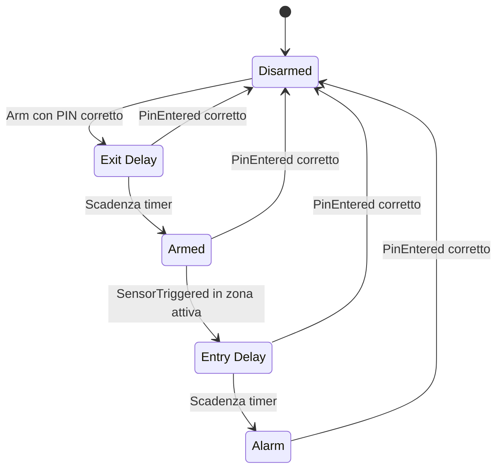

# Assignment-03 Report

## Programmazione Concorrente e Distribuita [25-26]

**Autore:** Nicola Graziotin (nicola.graziotin@studio.unibo.it)

---

## Indice

1. [Exercise 1 - Smart Home Alarm System (Scala, Pekko)](#exercise-1---smart-home-alarm-system-scala-pekko)
2. [Exercise 2 - Odds-and-Evens Game (Go)](#exercise-2---odds-and-evens-game-go)

---

## Exercise 1 - Smart Home Alarm System (Scala, Pekko)

### Analisi del problema

Il sistema è una centralina di allarme che reagisce a due sorgenti di eventi asincroni e indipendenti: gli **input dell'utente** dal tastierino e i **rilevamenti dei sensori**. La reazione non dipende dall'evento in sé ma dalla combinazione *evento + stato corrente*: lo stesso SensorTriggered deve essere ignorato da disinseriti, deve avviare l'entry delay da inseriti e non deve avere alcun effetto se l'allarme è già scattato.

#### Macchina a stati e vincoli temporali

Gli stati richiesti sono cinque, con queste transizioni:



I due ritardi (exit delay ed entry delay) sono il punto concettualmente più delicato: un'attesa bloccante della durata del timeout congelerebbe l'attore, che smetterebbe di ricevere PIN e segnali dai sensori proprio nella fase in cui deve reagire in fretta. Il timer deve quindi essere **non bloccante** e la scadenza deve rientrare nel sistema come un normale messaggio.

#### Zone e armamento parziale

Il requisito bonus introduce le zone. Da un punto di vista concorrente la conseguenza interessante è che la decisione "questo evento conta?" richiede uno stato condiviso tra tutti i sensori (quali zone sono attive): è la centralina a doverlo conoscere, non i sensori. Il sensore può quindi restare un componente stupido che segnala e basta.

### Design e implementazione

#### Gerarchia degli attori

L'albero è volutamente piatto: il guardian crea direttamente tutti gli attori figli e non esistono router intermedi.

```
Main.guardian (Behaviors.setup)
├── siren            (Siren: ON/OFF)
├── alarm-controller (AlarmController: FSM)
├── keypad           (Keypad: parsing input)
├── sensor-door      (Sensor: door-entrance / perimeter / door)
├── sensor-window    (Sensor: window-living  / perimeter / door)
├── sensor-living    (Sensor: motion-living  / living    / motion)
└── sensor-bedroom   (Sensor: motion-bedroom / sleeping  / motion)
```

- **AlarmController** è l'unico detentore dello stato del sistema: incassa comandi da keypad e sensori e comanda la sirena.
- **Keypad** traduce una riga di testo in un Command e la inoltra; non conosce lo stato del sistema.
- **Siren** è un attore a due behavior (off/on) comandato solo da messaggi, quindi la centralina non tocca mai direttamente lo stato della sirena.
- **Sensor** osserva l'ambiente e invia SensorTriggered(sensorId, zone, kind); non sa nulla di armamento.

#### Macchina a stati tramite behavior switching

Nessuna variabile mutabile condivisa: ogni stato è una funzione che restituisce un Behavior[Command] diverso.

```scala
private def disarmed(config, siren, timers): Behavior[Command] = ...
private def exitDelay(config, siren, timers, pendingZones): Behavior[Command] = ...
private def armed(config, siren, timers, activeZones): Behavior[Command] = ...
private def entryDelay(config, siren, timers, activeZones, triggeredBy): Behavior[Command] = ...
private def alarm(config, siren, timers, activeZones): Behavior[Command] = ...
```

Il vantaggio è che ogni stato dichiara *esplicitamente* quali messaggi gestisce. Un Arm ricevuto in Armed non è un caso dimenticato: è un branch che logga "già inserito, ignorato". Lo stato che serve ai fini della transizione (zone attive, sensore che ha causato l'intrusione) viaggia come **parametro della funzione**, quindi non esiste uno stato globale che possa essere letto in un momento incoerente.

#### Timer non bloccanti

Behaviors.withTimers fornisce un TimerScheduler[Command] passato a tutti gli stati. All'armamento:

```scala
timers.startSingleTimer(ExitTimerKey, ExitTimeout, config.exitDelay)
exitDelay(config, siren, timers, active)
```

La scadenza risveglia lo stesso attore con ExitTimeout, e la transizione avviene dentro il normale receive: nessun thread resta parcheggiato, nessun Thread.sleep. L'uso di **chiavi** (ExitTimerKey, EntryTimerKey) rende idempotente il timer e permette di annullarlo con timers.cancel(ExitTimerKey) quando l'utente digita il PIN corretto durante l'exit delay. Nel caso dell'entry delay, PIN corretto e EntryTimeout sono in gara: entrambi arrivano alla stessa mailbox, quindi vince il primo che viene processato e lo stato risultante è sempre coerente.

#### Sensori e simulazione

Sensor è parametrico su sensorId, zone, kind, intervallo e probabilità. Con startTimerAtFixedRate genera un Tick periodico e, con probabilità 0.25, invia l'evento alla centralina; il generatore casuale è inizializzato con sensorId.hashCode così il comportamento è riproducibile. Il comando TriggerNow permette di forzare un rilevamento da console. Sensori diversi (door e motion) usano lo stesso attore con parametri diversi: la tipologia è un dato, non una sottoclasse, perché il comportamento verso la centralina è identico.

#### Zone e armamento parziale

Arm(pin, zones) con zones vuoto significa armamento totale; altrimenti si fa l'intersezione con config.allZones e, se il risultato è vuoto, l'armamento viene rifiutato. Il Set delle zone attive viene passato agli stati Armed/EntryDelay/Alarm, e in Armed il controllo è una riga:

```scala
case SensorTriggered(id, zone, kind) =>
  if activeZones.contains(zone) then /* -> Entry Delay */
  else /* log e ignora */
```

Questo copre il caso d'uso "night mode" della traccia: armando solo perimeter, un movimento in sleeping viene loggato e ignorato.

#### Interazione utente e I/O

Il keypad è un attore, ma la lettura da console no: StdIn.readLine() è bloccante e un attore che la esegue smetterebbe di elaborare messaggi. La console gira quindi su un thread demone separato che invia Keypad.RawInput e, per il comando status, usa il pattern **ask** (GetStatus/Status) per ottenere una risposta dalla centralina senza condividerne lo stato. È l'unico punto del sistema con un'attesa sincrona, ed è confinato fuori dal sistema di attori.

### Conclusioni e verifica

Non ci sono test automatizzati con ScalaTest: la verifica è affidata a uno scenario guidato (comando demo) e all'esecuzione interattiva da console. La configurazione AlarmConfig.demo() riduce exit ed entry delay a 5 secondi per rendere il ciclo arm → intrusion → disarm veloce da osservare, mentre realistic() mantiene i valori della traccia (30s/20s). Il demo copre in sequenza: armamento totale, intrusione con PIN in tempo (nessun allarme), armamento parziale con evento in zona inattiva ignorato, intrusione in zona attiva con scadenza del timeout e attivazione della sirena, disinserimento finale.

L'output è interamente su log, il che rende leggibile la sequenza degli eventi ma non verifica nulla automaticamente.

---

## Exercise 2 - Odds-and-Evens Game (Go)

### Analisi del problema

Il torneo è un albero binario completo con $N = 2^m$ giocatori e $m$ round. Al round $r$ si giocano $2^{m-r}$ partite in parallelo e i vincitori avanzano; il numero totale di partite è $N-1$.

```mermaid
    usecase-beta
    P0 --> W0
    P1 --> W0
    P2 --> W1
    P3 --> W1

    P4 --> W2
    P5 --> W2
    P6 --> W3
    P7 --> W3

    W0 --> W01
    W1 --> W01
    W2 --> W23
    W3 --> W23

    W01 --> Champion
    W23 --> Champion
```

I vincoli concorrenti rilevanti sono due.

**Assenza di memoria condivisa.** Ogni giocatore deve avere uno stato proprio (il proprio numero, la propria sequenza casuale) e comunicare solo tramite messaggi. Questo esclude un array condiviso di risultati scritto da più goroutine.

**Sincronizzazione delle partite.** Due giocatori devono scambiarsi una mossa a testa. Il modo naturale di modellarlo è un canale condiviso tra i due, ma se entrambi si mettono in attesa di ricevere prima di inviare si bloccherebbero a vicenda: con messaggi sincroni serve che uno dei due faccia la prima mossa di comunicazione. Inoltre le partite dello stesso round devono poter procedere in parallelo, mentre il round successivo può iniziare solo quando tutti i vincitori sono noti.

### Design e implementazione

L'implementazione distingue tre tipi di goroutine:

- **giocatori** ($N$, uno per giocatore, vivi per tutto il torneo), ognuno con una propria inbox;
- **arbitri di partita** (uno per partita, creato a ogni round e poi terminato);
- **logger** (uno solo, che serializza l'output).

Il main/RunTournament fa solo da avvio e raccolta risultati: non instrada messaggi tra i giocatori.

#### Attori giocatore

Un giocatore è un ciclo su un canale di ingresso, con una mailbox bufferizzata:

```go
type PlayerMsg struct {
    Kind    MsgKind
    MatchID string
    Role    Role          // Odds oppure Evens
    ReplyCh chan<- PlayerResponse
}
```

Ogni giocatore ha un **canale dedicato** per tutta la durata del torneo: non cambia canale a ogni round, cambia solo l'interlocutore. Questo elimina la necessità di una matrice di canali calcolata a priori: l'arbitro della partita conosce già gli handle dei due giocatori e scrive nelle loro inbox. Il giocatore non deve sapere contro chi sta giocando né in quale posizione dell'albero si trova.

Alla ricezione di una richiesta il giocatore simula un tempo di riflessione (time.Sleep casuale fino a think-ms), estrae una mossa in $[0, 5]$ e risponde sul canale indicato nel messaggio. Alla fine del torneo riceve MsgQuit e termina.

#### Arbitro di partita e assenza di deadlock

Ogni partita è gestita da una goroutine dedicata che applica lo schema **request/reply**:

```go
replyOdds := make(chan PlayerResponse, 1)
replyEvens := make(chan PlayerResponse, 1)

odds.Inbox <- PlayerMsg{Kind: MsgPlay, MatchID: matchID, Role: Odds, ReplyCh: replyOdds}
evens.Inbox <- PlayerMsg{Kind: MsgPlay, MatchID: matchID, Role: Evens, ReplyCh: replyEvens}

respOdds := <-replyOdds
respEvens := <-replyEvens
```

Il deadlock non può verificarsi perché **l'arbitro non è un contendente**: è lui che invia per primo, e i giocatori si limitano a rispondere. Non esiste il caso simmetrico "entrambi aspettano di ricevere". I canali di risposta sono bufferizzati (capacità 1) e le inbox hanno capacità 4, così un giocatore che risponde non resta bloccato in attesa che l'arbitro legga, e l'arbitro che invia non resta bloccato in attesa che il giocatore consumi subito: il disallineamento di velocità tra i due non si propaga.

Questa è una scelta diversa rispetto a un torneo peer-to-peer puro, in cui i due giocatori si parlano direttamente su un canale comune e il ruolo (chi invia per primo) va dedotto dalla posizione nell'albero, ad esempio con una regola del tipo "chi sta a sinistra è server". Entrambe le soluzioni evitano il deadlock; qui il ruolo è semplicemente un campo del messaggio, e la simmetria non esiste per costruzione.

#### Assegnazione dei ruoli e decisione

I ruoli Odds ed Evens sono assegnati casualmente all'interno di ogni partita, con un generatore deterministico inizializzato da (seed, round, indice della partita): nel log le partite sono riproducibili a parità di seed. La casualità sui ruoli evita che lo stesso giocatore sia sempre Odds o sempre Evens quando il seed è fisso.

La decisione è una funzione pura, senza stato:

```go
func DecideWinner(oddsID, evensID, oddsMove, evensMove int) (winnerID, sum int) {
    sum = oddsMove + evensMove
    if sum%2 == 0 { return evensID, sum }
    return oddsID, sum
}
```

Somma pari → vince chi ha giocato il ruolo Evens, somma dispari → vince Odds. Essendo pura è anche l'unica parte del gioco banalmente testabile in isolamento.

#### Concorrenza tra round

Il torneo alterna due fasi:

1. **fase parallela**: per ogni coppia del round corrente viene lanciata una goroutine PlayMatch; tutte le partite del round procedono contemporaneamente;
2. **barriera**: il coordinatore legge esattamente numMatches risultati da un resultCh bufferizzato, riordina per indice e costruisce la lista dei vincitori per il round successivo.

La barriera è necessaria perché una partita del round $r+1$ coinvolge i vincitori di due partite del round $r$. La lettura dei risultati è un ciclo di <-resultCh, quindi il coordinatore non fa polling né attese attive. Il resultCh ha capacità pari al numero di partite del round: nessun arbitro resta bloccato a consegnare il risultato se il coordinatore è momentaneamente in ritardo.

I giocatori sconfitti non vengono terminati subito: restano in attesa sulla propria inbox e ricevono MsgQuit alla fine. Questo evita una goroutine che termina mentre un eventuale messaggio è in volo e semplifica la chiusura.

#### Logging

Tutti gli attori non stampano direttamente: emettono su un logCh bufferizzato (capacità 128) servito da una singola goroutine runLogger. Due motivi: le righe di partite concorrenti altrimenti si intreccerebbero, e fmt.Println è un'operazione lenta che, se eseguita dentro gli attori, falserebbe i tempi delle partite. Se il logger non è disponibile (logCh == nil) emit non fa nulla, così la logica del torneo è utilizzabile anche senza output.

#### Configurazione

Il programma è parametrizzato da flag: -players (alternativo a -rounds), -seed, -think-ms. NumRounds calcola $m$ per shift successivi e IsPowerOfTwo valida $N \ge 2$; -rounds è limitato a $[1, 12]$ per evitare di lanciare milioni di goroutine per un errore di battitura.

### Conclusioni e verifica

Il modello scelto è un **coordinamento centralizzato per partita**: lo stato del torneo (chi è ancora in gara, i risultati) è del coordinatore, mentre lo stato di gioco (la propria mossa) è del giocatore. Non c'è memoria condivisa: i giocatori si scambiano solo messaggi, e l'unica struttura letta da più goroutine, la mappa handle-per-ID, è di sola lettura dopo lo spawn.

Il compromesso rispetto a una soluzione completamente decentralizzata è che l'arbitro è un punto di sincronizzazione per la singola partita e il coordinatore impone una barriera per round: un round non può iniziare prima che il precedente sia concluso, anche se alcune partite sono già decise. In cambio si ottiene un codice molto più semplice: niente regole posizionali per i ruoli, niente canali calcolati in base all'ID, e un log ordinato per round e indice di partita.

Anche qui non ci sono test automatici: la verifica avviene eseguendo il programma con seed fissi e confrontando i log, oppure ripetendo l'esecuzione sui vari valori di -rounds/-players per controllare la validazione degli input.
