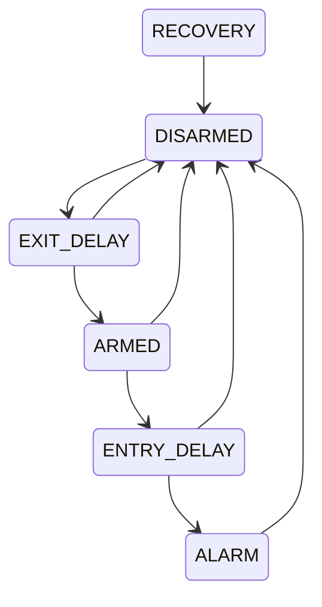

# Assignment-04 Report

## Programmazione Concorrente e Distribuita [25-26]

**Autore:** Nicola Graziotin (nicola.graziotin@studio.unibo.it)

---

## Indice

1. [Introduzione](#1-introduzione)
2. [Smart Home Alarm su cluster Pekko](#2-smart-home-alarm-su-cluster-pekko)
3. [Tic-Tac-Toe distribuito con Java RMI](#3-tic-tac-toe-distribuito-con-java-rmi)
4. [Sezioni critiche distribuite su MOM](#4-sezioni-critiche-distribuite-su-mom)
5. [Considerazioni finali](#5-considerazioni-finali)

---

## 1. Introduzione

I tre esercizi affrontano lo stesso problema da tre punti di vista diversi della
programmazione distribuita:

| Esercizio | Modello | Meccanismo di coordinamento |
|---|---|---|
| Smart Home Alarm | Attori e cluster sharding (Pekko Typed) | Messaggi asincroni, stato serializzato dal mailbox |
| Tic-Tac-Toe | Oggetti distribuiti (Java RMI) | Lock per partita, snapshot immutabili, callback |
| Sezioni critiche | Message-Oriented Middleware (RabbitMQ) | Algoritmo simmetrico di Ricart–Agrawala, clock di Lamport |

In tutti e tre i casi il punto centrale non è la logica applicativa, ma **chi
possiede lo stato condiviso e come vengono ordinate le operazioni concorrenti**
quando i componenti vivono su processi e nodi differenti.

---

## 2. Smart Home Alarm su cluster Pekko

### 2.1 Analisi del problema

Il sistema è un allarme domestico il cui comportamento è una macchina a stati:

I vincoli dell'assignment introducono aspetti distribuiti che non esistevano
nella versione locale:

- sensori, keypad e centralina possono girare su **nodi diversi** (almeno tre);
- la comunicazione tra nodi deve avvenire **solo tramite messaggi attore**;
- ogni sensore ha un sensorId e può essere motion oppure door/window;
- i ritardi di uscita e ingresso devono essere mantenuti;
- se l'entità di controllo viene ricreata, **il suo stato è perso** e deve
  entrare in una modalità sicura di recovery.

Dal punto di vista concorrente i problemi principali sono:

1. **Accesso concorrente allo stato della centralina.** Più keypad e più
   sensori possono inviare comandi nello stesso istante: un evento di intrusione
   può arrivare insieme a un PIN, oppure insieme allo scadere di un timer. Lo
   stato (armato/disarmato, zone attive, fase corrente) deve essere aggiornato da
   un solo scrittore alla volta.
2. **Ordine degli eventi.** Il timeout di exit/entry delay e i comandi devono
   essere valutati rispetto alla fase in cui il sistema si trova: un evento
   ricevuto in EXIT_DELAY non deve comportarsi come in ARMED.
3. **Località trasparente.** Keypad e sensori non devono conoscere il nodo
   fisico della centralina: questa può spostarsi per un guasto o un ribilanciamento.
4. **Fallimento parziale.** Un nodo può cadere; l'entità deve essere ricreata
   altrove, ma senza una copia dello stato precedente. Il requisito di sicurezza
   impone di non assumere né ARMED né DISARMED: l'unica uscita è il PIN.
5. **Assenza di memoria condivisa.** Non esistono lock distribuiti: la
   serializzazione deve nascere dal modello di concorrenza scelto.

### 2.2 Strategia adottata

**Cluster e ruoli.** Ogni nodo avvia lo stesso Main e legge la propria
configurazione da variabili d'ambiente (NodeSettings). I ruoli sono
controller, sensor, keypad; lo stesso processo può ricoprirne più di uno.
La topologia Docker usata per la dimostrazione è:

- seed: solo controller;
- node1: controller,sensor (failover del controller);
- node2: sensor,keypad (console su un nodo diverso dal controller).

**Cluster sharding come single-writer.** La centralina è una *entity sharded* con
id logico unico home-alarm, ospitata solo dai nodi con ruolo controller. Ogni
sensore è a sua volta una entity sharded con id pari al sensorId, ospitata dai
nodi sensor. Questo dà tre garanzie:

- esiste **una sola istanza** dell'entità per id, anche se più nodi potrebbero
  ospitarla;
- il mailbox dell'attore serializza i messaggi, quindi le transizioni di stato
  non hanno data race e non servono lock applicativi;
- su ogni nodo sharding.init crea un EntityRef proxy, per cui keypad e
  sensori spediscono comandi senza sapere dove si trovi l'entità.

**Macchina a stati come behavior.** Ogni stato è una funzione
Behavior[Command] con i dati immutabili che le servono (zone attive, zona
trigger). Il passaggio di stato è il ritorno del behavior successivo: non esiste
stato mutabile condiviso. I timeout sono startSingleTimer con messaggi
self-inviati (ExitTimeout, EntryTimeout), quindi anche le scadenze entrano
nello stesso mailbox e vengono ordinate rispetto agli altri comandi. Il wrapper
guarded intercetta RestartEntity in ogni stato: ferma l'entità, simulando la
perdita dello stato.

**Sensori.** All'avvio i nodi sensor richiedono la creazione di tutte le entity
note; lo sharding garantisce l'idempotenza (una entity per sensorId). Un timer
periodico genera eventi probabilistici, mentre TriggerNow permette alla
console di simulare un'intrusione su un sensore remoto. In entrambi i casi il
sensore invia SensorTriggered(id, zone, kind) all'EntityRef della centralina:
la comunicazione è sempre e solo a messaggi.

**Sicurezza e recovery.** L'entità non usa persistenza. Alla creazione parte
sempre in RECOVERY:

- ignora gli eventi dei sensori (li logga);
- rifiuta Arm;
- accetta solo il PIN corretto, che porta a DISARMED e spegne la sirena.

La sirena è un attore figlio dell'entità: vive sullo stesso nodo
dell'incarnazione corrente e, se l'entità viene ricreata altrove, la nuova
incarnazione nasce con una sirena spenta. La configurazione disattiva la
passivazione dello sharding, così l'FSM non viene fermata per inattività; lo
Split Brain Resolver (keep-majority) rimuove i nodi non più raggiungibili e
consente allo sharding di ricreare l'entità su un altro nodo controller.

**Serializzazione.** Tutti i messaggi che possono attraversare il confine di nodo
estendono CborSerializable, serializzato con Jackson CBOR; i messaggi locali
(timer, comandi della sirena) restano interni al nodo.

**Interazione.** La console gira su un thread dedicato solo sui nodi keypad.
I comandi di armamento e PIN passano dall'attore Keypad, che li traduce in
Arm/PinEntered e li invia all'EntityRef della centralina; gli altri comandi
(status, trigger, demo, restart) sono gestiti direttamente dalla console
e usano gli stessi EntityRef. status usa il pattern ask con timeout, così
il thread della console può attendere la risposta senza bloccare il sistema di
attori.

### 2.3 Limiti dichiarati

Non essendoci persistenza né event sourcing, i messaggi in volo durante il
failover possono andare persi e gli eventi persi non vengono riprodotti. La
modalità RECOVERY è volutamente conservativa: privilegia la sicurezza
(allarme mai disinserito implicitamente) rispetto alla continuità del servizio.
Non è inoltre previsto un componente di storage che ricostruisca l'ultimo stato
noto.

---

## 3. Tic-Tac-Toe distribuito con Java RMI

### 3.1 Analisi del problema

Il sistema deve permettere a un giocatore di creare una partita con un nome e a
un altro di unirsi, usando Java RMI come meccanismo RPC. Le entità sono:

- una **lobby** globale, esportata nel registry RMI, che crea e cerca partite;
- una **sessione** per giocatore, legata al simbolo X o O;
- un **listener** remoto esportato dal client, usato dal server per notificare
  gli eventi (inizio, mossa, fine, abbandono).

I problemi concorrenti nascono dal fatto che RMI serve ogni chiamata su un
thread diverso: due client possono invocare la lobby o la stessa partita in
parallelo. In particolare:

1. **Creazione concorrente con lo stesso nome.** Due create simultanei non
   devono riuscire entrambi.
2. **Join concorrente.** Due giocatori non devono occupare entrambi il secondo
   posto della stessa partita.
3. **Coerenza del turno e della board.** Una mossa deve essere validata e
   applicata atomicamente: controllo del turno, cella libera, aggiornamento,
   valutazione della vittoria.
4. **Callback lente o morte.** Se il server notifica un client mentre tiene un
   lock, un client lento blocca la partita; se due callback si incrociano si
   possono creare deadlock. Le notifiche devono quindi essere asincrone e
   ordinate per giocatore.
5. **Fallimenti parziali e pulizia.** Un client può chiudere, una sessione può
   non essere più raggiungibile, una partita può finire o essere abbandonata.
   Le risorse RMI (stub esportati, thread notificatori, entry nella lobby)
   devono essere rilasciate senza perdere notifiche già accodate.

Sul piano distribuito, il client non condivide memoria con il server: passano
solo snapshot serializzabili e eccezioni serializzabili. La sessione per
giocatore evita che il client debba (o possa) dichiarare il proprio simbolo a
ogni mossa: è il server a sapere chi sta chiamando.

### 3.2 Strategia adottata

**Interfacce e dati.** GameLobby, GameSession e PlayerListener estendono
Remote; BoardState è uno snapshot **immutabile** (copia difensiva
dell'array, nessun setter) e viene serializzato a ogni notifica. La gerarchia
GameException è serializzabile, così gli errori applicativi tornano al client
come eccezioni tipizzate (GameAlreadyExists, GameFull, GameNotFound,
InvalidMove, NotYourTurn).

**Lobby atomica.** LobbyImpl mantiene le partite in una ConcurrentHashMap.
La creazione usa putIfAbsent: solo un client può inserire un dato nome e
l'altro riceve GameAlreadyExistsException. La rimozione usa
remove(name, game), cioè rimuove solo l'istanza effettivamente presente, senza
cancellare una partita diversa creata nel frattempo con lo stesso nome.

**Lock per partita.** Ogni GameImpl ha un monitor privato che protegge board,
turno, lista giocatori, stato e flag closed. Ogni operazione segue lo stesso
schema:

1. valida e aggiorna lo stato sotto lock;
2. crea uno snapshot immutabile;
3. accoda le notifiche;
4. rilascia il lock;
5. esegue l'eventuale cleanup **fuori** dal lock.

Poiché partite diverse hanno lock diversi, non c'è contesa tra partite. Poiché
nessuna chiamata remota avviene sotto lock, un client lento non blocca la
partita e non si creano attese circolari tra server e client.

**Notifiche ordinate e isolate.** Ogni giocatore ha un
ExecutorService single-thread dedicato. Gli eventi vengono accodati sotto lock,
quindi l'ordine in cui il giocatore li vede coincide con l'ordine delle
transizioni di stato. Il client lento rallenta solo la propria coda, non quella
dell'avversario. Un RemoteException viene loggato e non interrompe la partita.

**Sessione come capability.** Al momento del join il server assegna X al primo
giocatore e O al secondo, esporta un GameSessionImpl già legato a quel
simbolo e restituisce lo stub. Il client non può giocare per l'avversario perché
non può scegliere il simbolo nella richiesta.

**Pulizia e rollback.** A fine partita, abbandono o errore, cleanup() rimuove
la partita dalla lobby, chiama shutdown() sui notificatori (che lascia
completare i task già accodati) e fa unexportObject delle sessioni. Se
l'esportazione della sessione fallisce dopo il join, il giocatore viene rimosso
con leave; se la creazione fallisce, la partita viene rimossa e abortita. Un
flag closed rende le operazioni di chiusura ripetibili senza effetti doppi.

**Lato client.** RunClient esporta un PlayerListenerImpl e ne passa lo stub
alla lobby. Il listener conserva l'ultima board in campi volatile e stampa
tramite un Console sincronizzato: le callback RMI girano su thread del runtime
RMI, mentre il thread principale legge da stdin, quindi il monitor evita output
interleaved.

### 3.3 Limiti dichiarati

Il server è un singolo punto di guasto: non ci sono repliche né persistenza
delle partite, quindi un riavvio del server perde la lobby. Non c'è failure
detection dei client: un client che muore senza invocare leave non viene
rilevato proattivamente (solo una successiva notifica fallita viene loggata). Le
code dei notificatori non hanno limite, quindi un client molto lento può
accumulare eventi in memoria. Infine le callback sono best-effort: non ci sono
acknowledgement né retry.

---

## 4. Sezioni critiche distribuite su MOM

### 4.1 Analisi del problema

Il middleware deve offrire a processi distribuiti una sezione critica (CS)
senza che un processo conosca identità, posizione o code degli altri. L'unico
punto di contatto è un broker RabbitMQ. Il problema è quindi un classico
**mutual exclusion distribuito**, con requisiti:

- **Safety (ME1):** al più un processo dentro la CS alla volta;
- **Liveness (ME2):** ogni richiesta prima o poi entra;
- **Fairness (ME3):** le richieste vengono ordinate secondo la relazione
  *happened-before*, non secondo la velocità dei processi.

Le difficoltà concorrenti sono:

1. **Nessun clock globale né memoria condivisa.** L'ordine va ricostruito con
   timestamp logici (Lamport).
2. **Messaggi asincroni e concorrenti.** Un processo può ricevere richieste
   mentre è fuori, mentre sta richiedendo o mentre è già dentro la CS.
3. **Membership dinamica.** Poiché il processo non conosce gli altri, deve
   scoprirli e sapere da chi aspettarsi un permesso. Un nodo che entra mentre
   una richiesta è in corso deve essere incluso tra i concedenti.
4. **Thread del middleware e thread applicativo.** Le callback del consumer
   RabbitMQ e il thread che chiama enterCS() accedono allo stesso stato: serve
   una sincronizzazione esplicita e un meccanismo di attesa/risveglio.
5. **Assenza di failure detection.** Il modello assume uscite pulite; un crash
   senza BYE può bloccare i superstiti in attesa di un GRANT che non arriverà.

### 4.2 Strategia adottata

**Algoritmo.** È stato implementato **Ricart–Agrawala**. Ogni processo mantiene
un clock di Lamport; per entrare incrementa il clock e invia in broadcast una
REQUEST(timestamp). Ogni altro processo:

- se non è interessato alla CS, risponde subito GRANT;
- se sta anch'esso richiedendo, confronta (timestamp, id): vince il timestamp
  minore, a parità vince l'id minore; la richiesta perdente viene **deferita**;
- se è già dentro la CS, deferisce ogni nuova richiesta.

All'uscita il processo invia GRANT a tutte le richieste deferite. La variante
adottata è leggermente più restrittiva dell'originale: anche chi è dentro la CS
deferisce, evitando che una richiesta vecchia ma arrivata in ritardo venga
concessa mentre la sezione è già occupata. L'ordinamento (timestamp, id) dà
la fairness: due richieste concorrenti hanno un ordine totale e deterministico.

**Topologia RabbitMQ.** Un solo topic exchange. Ogni processo dichiara una coda
esclusiva e auto-delete e la lega a due routing key:

- broadcast: HELLO, BYE, REQUEST raggiungono tutti;
- node.<id>: GRANT e le risposte HELLO raggiungono un solo nodo.

Il broker decoupla completamente i processi: cambiano solo host del broker e
proprio id, non la lista dei partecipanti.

**Membership.** All'avvio un processo si aggiunge a sé stesso, invia HELLO in
broadcast e attende ~500 ms per raccogliere gli HELLO dei processi avviati
contemporaneamente. Chi riceve un HELLO da un nodo nuovo risponde in unicast,
così la scoperta è bidirezionale. Se un nuovo nodo entra mentre il processo ha
una richiesta in corso, viene aggiunto ai pendingGrants e gli viene inviata
una REQUEST diretta: senza il suo GRANT non si entra. Alla chiusura viene
inviato BYE e il nodo viene rimosso dalla vista degli altri.

**Concorrenza in Java.** Tutto lo stato del protocollo (peers,
pendingGrants, deferredRequests, clock, flag) è protetto da un unico
monitor. Lo stesso monitor serializza anche gli invii, perché il Channel
RabbitMQ non è thread-safe. La callback del consumer gira su un thread di
dispatch del client AMQP; enterCS() gira sul thread applicativo e resta in
attesa con monitor.wait() finché pendingGrants non è vuoto oppure il
middleware viene chiuso. I risvegli arrivano da onGrant (ultimo permesso),
onBye (un nodo atteso è uscito) e close (chiusura). close imposta il flag
closed, invia BYE, sblocca gli eventuali waiter e chiude canale e
connessione; un shutdown hook lo invoca all'uscita della JVM. Ogni errore di
invio durante enterCS ripristina lo stato della richiesta e rilascia i grant
deferiti, così non si resta bloccati su una richiesta parziale. I messaggi
malformati vengono scartati e i messaggi con il proprio id ignorati.

### 4.3 Limiti dichiarati

Non c'è failure detection: un processo che muore senza BYE resta nella
membership e i superstiti possono attendere indefinitamente il suo GRANT. Non
sono gestite partizioni di rete né perdita di messaggi (si assume che il broker
li consegni finché è raggiungibile). Le viste della membership possono divergere
se un HELLO va perso. Il broker è un punto di guasto e un singolo broker non
garantisce disponibilità sotto partizione. Il costo è O(n) messaggi per ingresso
nella CS (una richiesta broadcast e n−1 grant), quindi O(n²) se tutti gli n
processi vogliono entrare una volta. La soluzione è adeguata all'esercizio, ma
per garanzie più forti servirebbe un servizio di consenso o un protocollo di
membership con quorum.

---

## 5. Considerazioni finali

I tre esercizi mostrano tre modi coerenti di affrontare lo stesso nodo
concettuale: **rendere seriale l'accesso a uno stato condiviso senza introdurre
attese circolari o blocchi globali**.

- Nel cluster Pekko la serializzazione è *strutturale*: il mailbox dell'entity
  sharded è l'unico punto di ingresso allo stato, quindi non esistono lock
  applicativi. Lo sharding fornisce inoltre un single-writer per id e la
  località trasparente. Il prezzo è l'assenza di persistenza: al failover lo
  stato in memoria si perde e la recovery deve essere progettata come modalità
  sicura.
- In RMI la serializzazione è *esplicita*: un lock per partita protegge
  validazione e aggiornamento, mentre snapshot immutabili e callback su code
  dedicate tengono le chiamate remote fuori dalla sezione critica. Questo evita
  sia il blocco su client lenti sia i deadlock tra lock e callback.
- Nel MOM non esiste un proprietario dello stato: il coordinamento è *simmetrico*
  e basato su timestamp logici e scambio di permessi. La mutua esclusione è
  garantita dall'algoritmo, non da un lock o da un nodo centrale; il broker
  fornisce solo il trasporto.

In tutti i casi le scelte di concorrenza sono state guidate dagli stessi
principi: non tenere risorse condivise durante operazioni lente o remote,
definire un ordine deterministico degli eventi, isolare i fallimenti e
rilasciare sempre le risorse allocate.
